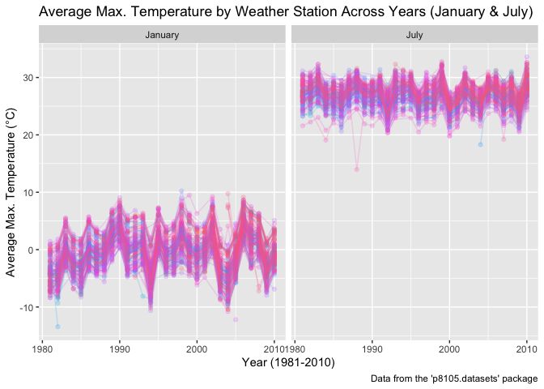
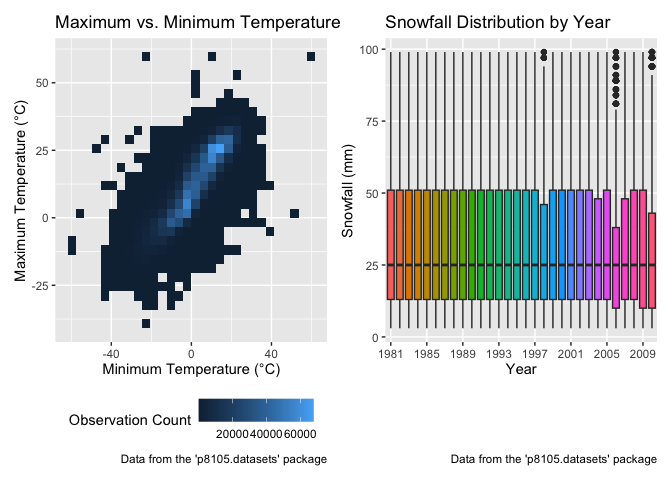
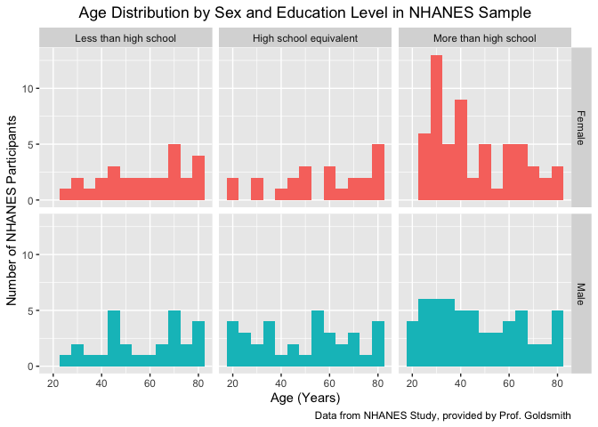
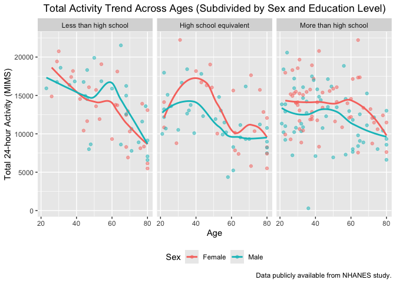
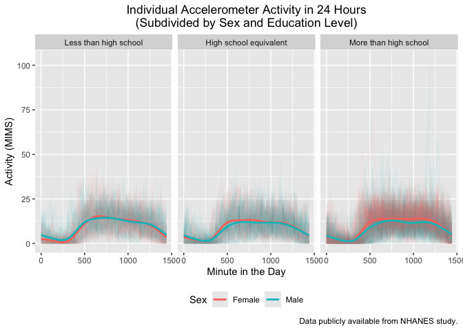
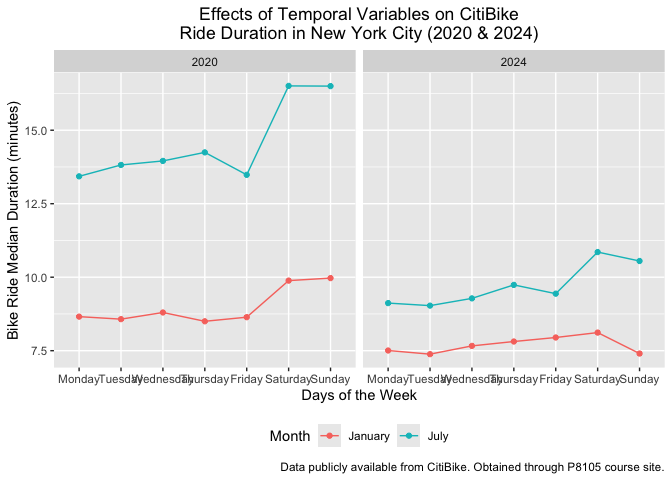
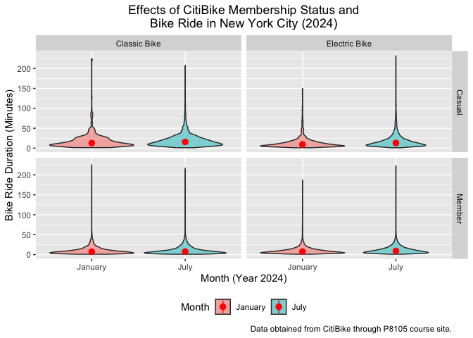

p8105_hw3_daq2107
================
Diego A. Quintana Licona
2026-10-19

## Loading necessary libraries for this assignment:

``` r
library(p8105.datasets) # To load our data
library(tidyverse) # For pipes and ggplot
```

    ## Warning: package 'readr' was built under R version 4.5.2

    ## ── Attaching core tidyverse packages ──────────────────────── tidyverse 2.0.0 ──
    ## ✔ dplyr     1.2.0     ✔ readr     2.2.0
    ## ✔ forcats   1.0.1     ✔ stringr   1.6.0
    ## ✔ ggplot2   4.0.2     ✔ tibble    3.3.1
    ## ✔ lubridate 1.9.5     ✔ tidyr     1.3.2
    ## ✔ purrr     1.2.1     
    ## ── Conflicts ────────────────────────────────────────── tidyverse_conflicts() ──
    ## ✖ dplyr::filter() masks stats::filter()
    ## ✖ dplyr::lag()    masks stats::lag()
    ## ℹ Use the conflicted package (<http://conflicted.r-lib.org/>) to force all conflicts to become errors

``` r
library(hexbin) # Using for Problem 1 plot
```

    ## Warning: package 'hexbin' was built under R version 4.5.2

``` r
library(patchwork) # For visualization
library(ggridges) # For visualization
library(lubridate) # For Problem 1
```

## Problem 1: National Oceanic and Atmospheric Administration (NOAA) Data Set

Our problem utilizes data from the NY National Oceanic and Atmospheric
Administration (NOAA) data. To start, we will load and explore the data.
Per the instructions, our data is obtained from our course’s
*p8105.datasets* package, loaded above. We can then use the *head()*,
*nrow()*, and *ncol()* functions to explore our variables:

``` r
# Loading the NOAA data:

data("ny_noaa")

# Exploring our data set:

head(ny_noaa) # Obtaining the names of the variables in the data set
```

    ## # A tibble: 6 × 7
    ##   id          date        prcp  snow  snwd tmax  tmin 
    ##   <chr>       <date>     <int> <int> <int> <chr> <chr>
    ## 1 US1NYAB0001 2007-11-01    NA    NA    NA <NA>  <NA> 
    ## 2 US1NYAB0001 2007-11-02    NA    NA    NA <NA>  <NA> 
    ## 3 US1NYAB0001 2007-11-03    NA    NA    NA <NA>  <NA> 
    ## 4 US1NYAB0001 2007-11-04    NA    NA    NA <NA>  <NA> 
    ## 5 US1NYAB0001 2007-11-05    NA    NA    NA <NA>  <NA> 
    ## 6 US1NYAB0001 2007-11-06    NA    NA    NA <NA>  <NA>

``` r
str(ny_noaa) # Obtaining the data types of each variable
```

    ## tibble [2,595,176 × 7] (S3: tbl_df/tbl/data.frame)
    ##  $ id  : chr [1:2595176] "US1NYAB0001" "US1NYAB0001" "US1NYAB0001" "US1NYAB0001" ...
    ##  $ date: Date[1:2595176], format: "2007-11-01" "2007-11-02" ...
    ##  $ prcp: int [1:2595176] NA NA NA NA NA NA NA NA NA NA ...
    ##  $ snow: int [1:2595176] NA NA NA NA NA NA NA NA NA NA ...
    ##  $ snwd: int [1:2595176] NA NA NA NA NA NA NA NA NA NA ...
    ##  $ tmax: chr [1:2595176] NA NA NA NA ...
    ##  $ tmin: chr [1:2595176] NA NA NA NA ...
    ##  - attr(*, "spec")=
    ##   .. cols(
    ##   ..   id = col_character(),
    ##   ..   date = col_date(format = ""),
    ##   ..   prcp = col_integer(),
    ##   ..   snow = col_integer(),
    ##   ..   snwd = col_integer(),
    ##   ..   tmax = col_character(),
    ##   ..   tmin = col_character()
    ##   .. )

``` r
# We can also look at the extent of NA values in each variable using a pipe with the summarize() function:

ny_noaa %>% 
  summarize(
    prop_na_id = mean(is.na(id)), # Gets me the proportion of NAs in each variable
    prop_na_date = mean(is.na(date)),
    prop_na_prcp = mean(is.na(prcp)),
    prop_na_snow = mean(is.na(snow)), 
    prop_na_snwd = mean(is.na(snwd)),
    prop_na_tmax = mean(is.na(tmax)),
    prop_na_tmin = mean(is.na(tmin))
  )
```

    ## # A tibble: 1 × 7
    ##   prop_na_id prop_na_date prop_na_prcp prop_na_snow prop_na_snwd prop_na_tmax
    ##        <dbl>        <dbl>        <dbl>        <dbl>        <dbl>        <dbl>
    ## 1          0            0       0.0562        0.147        0.228        0.437
    ## # ℹ 1 more variable: prop_na_tmin <dbl>

**Dataset Description:** The dataset (previously cleaned for our class
by Prof. Goldsmith) is comprised of 2595176 observations and the 7
variables. The variables contain information on the weather station ID
(*id*; character type), date of observation (*date*; date variable),
precipitation in tenths of a millimeter (*prcp*; integer variable),
millimeters of snowfall (*snow*; integer variable), millimeter of snow
depth (*snwd*; integer variable), maximum temperature in tenths of
degrees Celsius (*tmax*; character variable), and minimum temperature in
tenths of degrees Celsius (*tmin*; character variable).

Regarding missing values (NAs), we see that there are none for our ID
and Date variables; however, there is a considerable amount of missing
data for each of the remaining 5 variables, with 5.62% of observations
missing in *prcp*, 14.69% of observations missing in *snow*, 22.8% of
observations missing in *snwd*, 43.71% of observations missing in
*tmax*, and 43.71% of observations missing in *tmin*. This is
particularly concerning for the precipitation and maximum temperature
variables since it represents about half of the observations.

### Cleaning The Data

After analyzing the extent of the NA issue, we can go ahead and do some
data cleaning. We first construct new day, month, and year variables
from our already existing *date* variable using our reliable *mutate()*
function. Second, in order to convert our precipitation, temperature,
and snowfall variables into reasonable units, we need to recognize that
these variables are given in tenths of their units of measure.
Therefore, we can just take advantage of the *mutate()* pipe and do
simple division by 10. We can leave our *snow* variable as is since it
is already in regular millimeters:

``` r
# The 'day()', 'month()', and 'year()' functions I learned last semester during one of my classes using the lubridate package, which is part of tidyverse. Notice also that I had to convert my variables to numeric due to errors:

ny_noaa_cleaned =
  ny_noaa %>% 
  mutate(
    day = as.numeric(day(date)), # Creating my day, month, year variables
    month = as.numeric(month(date)),
    year = as.numeric(year(date)),
    prcp = as.numeric(prcp)/10,
    tmax = as.numeric(tmax)/10,
    tmin = as.numeric(tmin)/10,
    snwd = as.numeric(snwd)
  )

# Checking the newly created variables:

# Checking the dates:

ny_noaa_cleaned %>% 
  select(day, month, year) %>% 
  head()
```

    ## # A tibble: 6 × 3
    ##     day month  year
    ##   <dbl> <dbl> <dbl>
    ## 1     1    11  2007
    ## 2     2    11  2007
    ## 3     3    11  2007
    ## 4     4    11  2007
    ## 5     5    11  2007
    ## 6     6    11  2007

``` r
# From the output of this quick check, the code worked :)

# Now, checking the numerical variables:

ny_noaa_cleaned %>% 
  summarize(
    mean_prcp = mean(prcp, na.rm = TRUE), # Removing my NAs for quick check
    mean_snow = mean(snow, na.rm = TRUE),
    mean_tmax = mean(tmax, na.rm = TRUE),
    mean_tmin = mean(tmin, na.rm = TRUE)
  )
```

    ## # A tibble: 1 × 4
    ##   mean_prcp mean_snow mean_tmax mean_tmin
    ##       <dbl>     <dbl>     <dbl>     <dbl>
    ## 1      2.98      4.99      14.0      3.03

``` r
# The mean values appear in decent units, so our conversion also worked.
```

We can now proceed to assess which are the most commonly observed values
for our snowfall variable. We can make use of the *count()* function we
have used in the past to get the counts of values in the *snow*
variable. Then, in a pipe, we can make use of the *arrange()* function
we learned in our data wrangling lecture to arrange our values in
descending order:

``` r
ny_noaa_cleaned %>% 
  count(snow) %>% 
  arrange(desc(n)) # Using 'desc' to get output in descending order rather than ascending
```

    ## # A tibble: 282 × 2
    ##     snow       n
    ##    <int>   <int>
    ##  1     0 2008508
    ##  2    NA  381221
    ##  3    25   31022
    ##  4    13   23095
    ##  5    51   18274
    ##  6    76   10173
    ##  7     8    9962
    ##  8     5    9748
    ##  9    38    9197
    ## 10     3    8790
    ## # ℹ 272 more rows

**ANSWER:** From the output, we can see that the most common value is 0
millimeters of snowfall, with 2008508 observations. This makes sense
since snow does not fall for most days of the year in New York. We can
see that the second most common value is our NAs, with 381221
observations, which indicates that snowfall was not recorded for a
substantial number of stations. Moreover, we see that the third most
common value when there is actual snowfall is 25 millimeters, with 31022
observations, which is a relatively small amount of snow.

### Two-Panel Plot: Average Max. Temperature

After our initial cleaning and exploring, we can create a two-panel plot
by making use of the *ggplot* package, which is embedded within the
*tidyverse*. Since we are only asked to show the maximum temperatures
for the months of July and January across different years, we can use
the *filter()* function along with our *group_by()* function to group by
different weather stations as well as months and years. Moreover, to get
our average maximum temperature, we can make use of *summarize()* in the
same fashion as we did above:

``` r
ny_noaa_cleaned %>% 
  filter(month %in% c(7, 1)) %>% # Recall our months are in number format
  mutate( # Making use of mutate like in HW2 assignment to relabel my months
    month = case_match(
      month,
      1 ~ "January", # Matching '1' to 'January'
      7 ~ "July"), # Matching '7' to 'July'
    ) %>% 
  group_by(year, month, id) %>% # Grouping by month, year, and ID
  summarize(
    mean_tmax = mean(tmax, na.rm = TRUE)
  ) %>% 
  ggplot(
    aes(x = year, y = mean_tmax, group = id)) +
   geom_point(aes(color = id), alpha = .2) + # Following example from lecture
  geom_line(aes(color = id), alpha = .2) +
  facet_grid(. ~ month) + 
  theme(legend.position = "none") + # Had too many weather IDs
  labs(title = "Average Max. Temperature by Weather Station Across Years (January & July)", 
       x = "Year (1981-2010)",   # Adding labels like I did in HW1
       y = "Average Max. Temperature (°C)",
       caption = "Data from the 'p8105.datasets' package")
```

    ## Warning: There was 1 warning in `mutate()`.
    ## ℹ In argument: `month = case_match(month, 1 ~ "January", 7 ~ "July")`.
    ## Caused by warning:
    ## ! `case_match()` was deprecated in dplyr 1.2.0.
    ## ℹ Please use `recode_values()` instead.

    ## `summarise()` has regrouped the output.
    ## ℹ Summaries were computed grouped by year, month, and id.
    ## ℹ Output is grouped by year and month.
    ## ℹ Use `summarise(.groups = "drop_last")` to silence this message.
    ## ℹ Use `summarise(.by = c(year, month, id))` for per-operation grouping
    ##   (`?dplyr::dplyr_by`) instead.

    ## Warning: Removed 5970 rows containing missing values or values outside the scale range
    ## (`geom_point()`).

    ## Warning: Removed 5932 rows containing missing values or values outside the scale range
    ## (`geom_line()`).

<!-- -->

As we can see from the output, ggplot automatically removes the NA
values for visualization purposes. Moreover, we can see that the plot
shows a general (and expected) pattern where January is colder than
July. We also see that most of the observations follow an apparent
structure: they conglomerate around 0°C for January, whereas they
conglomerate around 28°C for July. There is some outlier variability,
with a sudden drop in average max temperature around 1995 for January.
There is not much variation for the July data except for a data point
around 1988.

### Two-Panel Plot: Max. vs. Min Temperature

We can now proceed to make an additional two-panel plot using the
maximum and minimum temperature values (variables *tmax* and *tmin*,
respectively) with the entirety of our data set. We can do this in a
fashion similar to above, but we will now utilize the *hexbin* package
to create graphs other than a scatter plot for the minimum vs. maximum
temperature plot. I used the 2-D Bin approach to show the association of
the two continuous variables. For the snowfall plot, since we are
dealing with an univariate (categorical vs. continuous) plot, I
initially thought of creating a density distribution. However, it did
not allow me to create a good comparison and the number of years made it
trickier. So I opted for a boxplot to better see descriptive statistics
like IQR range and median, and added slight jumps in years and also
color to make it more digestible visually:

``` r
# Following a similar process like above plus what we learned in lecture, we can create two data frames for each of the panels:

# Min and max temperature plot (i):

ggp_maxnmin = # Following naming conventions from lecture
  ny_noaa_cleaned %>% # Note we don't need to modify our data in this one
  ggplot(
    aes(x = tmin, y = tmax)) +
  geom_bin2d() + 
  theme(legend.position = "bottom") +
  labs(title = "Maximum vs. Minimum Temperature", 
       x = "Minimum Temperature (°C)", 
       y = "Maximum Temperature (°C)",
       fill = "Observation Count",
       caption = "Data from the 'p8105.datasets' package")
  
# Snowfall distribution plot (ii):

# Since we need to make sure that the distribution of snowfall has no values less than zero or greater than 100, we can make use of the 'filter' function. Moreover, we can make use of the 'fill' argument to make the distinctions by year:

ggp_snowdist =
  ny_noaa_cleaned %>% 
  filter(
    snow > 0, snow < 100
  ) %>% 
  ggplot(
    aes(x = as.factor(year), y = snow, fill = as.factor(year))) +
  geom_boxplot(show.legend = FALSE) +
  scale_x_discrete(breaks = seq(1981, 2010, by = 4)) + # I Googled this command for ggplot
  theme(legend.position = "bottom") +
  labs(title = "Snowfall Distribution by Year", 
       x = "Year", 
       y = "Snowfall (mm)",
       caption = "Data from the 'p8105.datasets' package")

# Now, putting everything together:

ggp_maxnmin + ggp_snowdist
```

    ## `stat_bin2d()` using `bins = 30`. Pick better value `binwidth`.

    ## Warning: Removed 1136276 rows containing non-finite outside the scale range
    ## (`stat_bin2d()`).

<!-- -->

**Description:** From the output, we can see that the left
panel–corresponding to the Maximum vs. Minimum Temperature–shows a
positive correlation between the two variables. This makes sense since
we expect temperatures to not differ too much in a single day. Moreover,
we see that in the case of the right panel, where we restricted to show
between 0-100 mm of snowfall, the medians and IQR ranges remained
consistent across the years. However, we also see that the years 1998,
2006, and 2010 show multiple outliers.

## Problem 2: Accelerometer Data in the NHANES Study

Our problem utilizes accelerometer data from the National Health and
Nutrition Examination Survey (NHANES) research study.To start, we will
load the data and proceed to tidy it. We must note that the data is in
CSV format, so we need to use the *read_csv()* function (part of
tidyverse package) to import our file. From manual inspection, I saw
that we needed to skip 4 rows in the demographic data CSV in order to
get to our data.

Moreover, we use the *filter()* function to only include participants
who are 21 years of age or older, and can use *drop_na()* in order to
drop missing values for the demographic variables. Moreover, the
demographic data CSV contained the numeric codes utilized for each
variable, so I relabeled to give appropriate names using *case_match()*
like we did in Problem 1, and we convert to ordered factors:

``` r
# Loading each data set individually:

accel_data =
  read_csv(file = "./HW3_Data/nhanes_accel.csv",
           na = c("","NA", ".") # We use this to make sure R understands these patterns as NA
           ) %>% 
  janitor::clean_names() # Cleaning names
```

    ## Rows: 250 Columns: 1441
    ## ── Column specification ────────────────────────────────────────────────────────
    ## Delimiter: ","
    ## dbl (1441): SEQN, min1, min2, min3, min4, min5, min6, min7, min8, min9, min1...
    ## 
    ## ℹ Use `spec()` to retrieve the full column specification for this data.
    ## ℹ Specify the column types or set `show_col_types = FALSE` to quiet this message.

``` r
covar_data =
  read_csv(file = "./HW3_Data/nhanes_covar.csv",
           na = c("","NA", "."),
           skip = 4, # Skipping first four rows
           ) %>% 
  janitor::clean_names() %>% # Cleaning names
  filter(
    age >= 21 #Only including people 21 and older
  ) %>% 
  drop_na(sex, age, bmi, education) %>%  #Dropping observations with missing values
  mutate(
    education = case_match(
      education,
      1 ~ "Less than high school", # using exact names from CSV
      2 ~ "High school equivalent",
      3 ~ "More than high school"),
    
    sex = case_match(
      sex,
      1 ~ "Male", 
      2 ~ "Female")
    ) %>% 
  mutate( # Now we need to make factors and organize
    sex = as.factor(sex),
    education = factor(education, levels = c("Less than high school", "High school equivalent", "More than high school"))
  )
```

    ## Rows: 250 Columns: 5
    ## ── Column specification ────────────────────────────────────────────────────────
    ## Delimiter: ","
    ## dbl (5): SEQN, sex, age, BMI, education
    ## 
    ## ℹ Use `spec()` to retrieve the full column specification for this data.
    ## ℹ Specify the column types or set `show_col_types = FALSE` to quiet this message.

``` r
# Used these lines of code to continuously inspect my data frame as I was going about adding cleaning steps in my pipes:

head(accel_data, 5)
```

    ## # A tibble: 5 × 1,441
    ##    seqn  min1  min2  min3  min4  min5  min6  min7  min8   min9 min10 min11
    ##   <dbl> <dbl> <dbl> <dbl> <dbl> <dbl> <dbl> <dbl> <dbl>  <dbl> <dbl> <dbl>
    ## 1 62161  1.11  3.12  1.47 0.938  1.60 0.145 2.10  0.509  1.63   1.20 0.947
    ## 2 62164  1.92  1.67  2.38 0.935  2.59 5.22  2.39  4.90   1.97   3.13 2.77 
    ## 3 62169  5.85  5.18  4.76 6.48   6.85 7.24  6.12  7.48   5.47   6.49 5.14 
    ## 4 62174  5.42  3.48  3.72 3.81   6.85 4.45  0.561 1.61   0.698  2.72 4.85 
    ## 5 62177  6.14  8.06  9.99 6.60   4.57 2.78  7.10  7.25  10.1    7.49 2.72 
    ## # ℹ 1,429 more variables: min12 <dbl>, min13 <dbl>, min14 <dbl>, min15 <dbl>,
    ## #   min16 <dbl>, min17 <dbl>, min18 <dbl>, min19 <dbl>, min20 <dbl>,
    ## #   min21 <dbl>, min22 <dbl>, min23 <dbl>, min24 <dbl>, min25 <dbl>,
    ## #   min26 <dbl>, min27 <dbl>, min28 <dbl>, min29 <dbl>, min30 <dbl>,
    ## #   min31 <dbl>, min32 <dbl>, min33 <dbl>, min34 <dbl>, min35 <dbl>,
    ## #   min36 <dbl>, min37 <dbl>, min38 <dbl>, min39 <dbl>, min40 <dbl>,
    ## #   min41 <dbl>, min42 <dbl>, min43 <dbl>, min44 <dbl>, min45 <dbl>, …

``` r
head(covar_data, 5)
```

    ## # A tibble: 5 × 5
    ##    seqn sex      age   bmi education             
    ##   <dbl> <fct>  <dbl> <dbl> <fct>                 
    ## 1 62161 Male      22  23.3 High school equivalent
    ## 2 62164 Female    44  23.2 More than high school 
    ## 3 62169 Male      21  20.1 High school equivalent
    ## 4 62174 Male      80  33.9 More than high school 
    ## 5 62177 Male      51  20.1 High school equivalent

After we tidied our data, we can now proceed to merge it. For this, we
will make use of the common *SEQN* variable that is found in both data
frames. From the data wrangling lectures, we know that we can use the
*left_join()* function to do this so that we can preserve the
observations from the cleaned demographic data:

``` r
nhanes_merged = 
  left_join(covar_data, accel_data, by = "seqn") #Starting from the cleaned demographic data

# Checking the new data frame:

head(nhanes_merged, 5)
```

    ## # A tibble: 5 × 1,445
    ##    seqn sex      age   bmi education    min1  min2  min3  min4  min5  min6  min7
    ##   <dbl> <fct>  <dbl> <dbl> <fct>       <dbl> <dbl> <dbl> <dbl> <dbl> <dbl> <dbl>
    ## 1 62161 Male      22  23.3 High schoo…  1.11  3.12  1.47 0.938  1.60 0.145 2.10 
    ## 2 62164 Female    44  23.2 More than …  1.92  1.67  2.38 0.935  2.59 5.22  2.39 
    ## 3 62169 Male      21  20.1 High schoo…  5.85  5.18  4.76 6.48   6.85 7.24  6.12 
    ## 4 62174 Male      80  33.9 More than …  5.42  3.48  3.72 3.81   6.85 4.45  0.561
    ## 5 62177 Male      51  20.1 High schoo…  6.14  8.06  9.99 6.60   4.57 2.78  7.10 
    ## # ℹ 1,433 more variables: min8 <dbl>, min9 <dbl>, min10 <dbl>, min11 <dbl>,
    ## #   min12 <dbl>, min13 <dbl>, min14 <dbl>, min15 <dbl>, min16 <dbl>,
    ## #   min17 <dbl>, min18 <dbl>, min19 <dbl>, min20 <dbl>, min21 <dbl>,
    ## #   min22 <dbl>, min23 <dbl>, min24 <dbl>, min25 <dbl>, min26 <dbl>,
    ## #   min27 <dbl>, min28 <dbl>, min29 <dbl>, min30 <dbl>, min31 <dbl>,
    ## #   min32 <dbl>, min33 <dbl>, min34 <dbl>, min35 <dbl>, min36 <dbl>,
    ## #   min37 <dbl>, min38 <dbl>, min39 <dbl>, min40 <dbl>, min41 <dbl>, …

``` r
# It worked!
```

### Producing Reader-Friendly Table

To create our table, we can make use of the *pivot_wider()* function
that we covered in our data wrangling lectures. We can use the *count()*
function we used in Problem 1 to obtain the counts of men and women in
each education category. Then, as we saw in the EDA lecture, we use
*knitr::kable()* to make this reader-friendly:

``` r
nhanes_merged %>% 
  group_by(education, sex) %>% # Grouping by the variables we need
  summarize(
    n = n() # getting our counts
  ) %>% 
  pivot_wider(
    names_from = sex,
    values_from = n
  ) %>% 
  knitr::kable(col.names = c("Education", "Female", "Male"))
```

    ## `summarise()` has regrouped the output.
    ## ℹ Summaries were computed grouped by education and sex.
    ## ℹ Output is grouped by education.
    ## ℹ Use `summarise(.groups = "drop_last")` to silence this message.
    ## ℹ Use `summarise(.by = c(education, sex))` for per-operation grouping
    ##   (`?dplyr::dplyr_by`) instead.

| Education              | Female | Male |
|:-----------------------|-------:|-----:|
| Less than high school  |     28 |   27 |
| High school equivalent |     23 |   35 |
| More than high school  |     59 |   56 |

**Table Description:** From the table, we can see that the individuals
in our sample who have an education level corresponding to less than
high school are evenly split between males and females, with 27 males
and 28 females. However, males dominate in the high school equivalent
level, with 35 males and 23 females. Lastly, once we reach upper levels
of education, females take the lead in the more than high school
category, with 56 males and 59 females.

### Visualizing Age Distribution Across Sex and Education Levels

We can assess the differences in the distribution of age across sex and
education level categories. To do this, we will use or merged NHANES
data frame and make use of *ggplot* in the same fashion before. I went
with a histogram given we are doing a continuous vs. categorical
variable, and faceted by both sex and education level, since facetting
only by education led to an overcrowded figure that was hard to
interpret:

``` r
nhanes_merged %>% 
  ggplot(
    aes(x = age, fill = sex)) +
  geom_histogram(binwidth = 5, position = "dodge") + # Dodge avoids overlap
  facet_grid(sex ~ education) + # Facetting by education level and sex to better over intersection
  theme(legend.position = "none",
        plot.title = element_text(hjust = 0.5)) + # Centering the title
  labs(title = "Age Distribution by Sex and Education Level in NHANES Sample", 
       x = "Age (Years)", 
       y = "Number of NHANES Participants",
       caption = "Data from NHANES Study, provided by Prof. Goldsmith")
```

<!-- -->

**Figure Description:** From the figure, we can see that for those with
an education level higher than high school, there is a bigger
concentration of people in the 20-40 years of age. This makes sense
since these are the ages when people usually attend college and/or
graduate school. We also can see that in this education and age group,
there is a higher concentration of female individuals. On a more general
level, there seems to be an equitable distribution of the number of
participants between less than high school and highs chool equivalent
education levels, with an overall bigger concentration for those with
education higher than high school. In these high school or lower
categories, there is a more prominent concentration of older
participants, especially around ages 70-80. We can speculate that this
may due that, in older times, it was more common to interrupt one’s
studies at the high school (or below) level.

### Total Activity per Participant

From our cleaned data frame, we can now produce a new variable
representing the total activity from each of the participants in the
sample. Quick visual inspection of the accelerometer data reveals that
it was collected by the minute. Therefore, we can make use of the
*pivot_longer()* function we covered in our data wrangling sessions and
used in Homework 2. We also need to recall that, based on the article
provided by Prof. Goldsmith, we use the unit *MIMS*, which stands for
*Monitor-Independent Movement Summary unit (MIMS-unit)*, to refer to our
values for each minute of a 24-hour day starting at midnight:

``` r
total_act_df =
  nhanes_merged %>% 
  pivot_longer(
    min1:min1440, # Checked how many minutes are in a day to obtain this
    names_to = "minute",
    values_to = "MIMS" # Using the naming convention from the instructions and article
  ) %>% 
  group_by(seqn, sex, age, bmi, education) %>% # Grouping minute rows and keeping demographics
  summarize(total_act = sum(MIMS, na.rm = TRUE) # Getting our total activity by summing day MIMS
  )
```

    ## `summarise()` has regrouped the output.
    ## ℹ Summaries were computed grouped by seqn, sex, age, bmi, and education.
    ## ℹ Output is grouped by seqn, sex, age, and bmi.
    ## ℹ Use `summarise(.groups = "drop_last")` to silence this message.
    ## ℹ Use `summarise(.by = c(seqn, sex, age, bmi, education))` for per-operation
    ##   grouping (`?dplyr::dplyr_by`) instead.

``` r
# We now quickly inspect the new data frame:

head(total_act_df, 5)
```

    ## # A tibble: 5 × 6
    ## # Groups:   seqn, sex, age, bmi [5]
    ##    seqn sex      age   bmi education              total_act
    ##   <dbl> <fct>  <dbl> <dbl> <fct>                      <dbl>
    ## 1 62161 Male      22  23.3 High school equivalent    13194.
    ## 2 62164 Female    44  23.2 More than high school     13411.
    ## 3 62169 Male      21  20.1 High school equivalent     9991.
    ## 4 62174 Male      80  33.9 More than high school      8579.
    ## 5 62177 Male      51  20.1 High school equivalent    11918.

### Total Activity Across Age, Sex, and Education Groups

We successfully created our total activity variable and kept our
demographic variables! We can now proceed to create our total activity
vs. age graph while comparing the sexes and having separate panels for
each education level. We will, of course, make use of ggplot for this:

``` r
total_act_df %>% 
  ggplot(
    aes(x = age, y = total_act, color = sex)) +
  geom_point(aes(color = sex), alpha = 0.5) + # Grabbed from lecture example
  geom_smooth(se = FALSE) +
  theme(legend.position = "bottom",
        plot.title = element_text(hjust = 0.5),) + # Googled how to center my title in ggplot
  facet_grid(. ~ education) + 
  labs(title = "Total Activity Trend Across Ages (Subdivided by Sex and Education Level)", 
       x = "Age", 
       y = "Total 24-hour Activity (MIMS)",
       color = "Sex",
       caption = "Data publicly available from NHANES study.")
```

    ## `geom_smooth()` using method = 'loess' and formula = 'y ~ x'

<!-- -->

**Plot Description:** The graphs produced clearly demonstrate a negative
correlation between total activity (in MIMS) and age, where people
become more sedentary as they become older, irrespective of age or
education level. Moreover, we see slight increases in activity after the
age of 60, potentially due to post-retirement activities.

However, we can see that the decline in total activity is more
pronounced for those with an education level less than high school, with
female individuals in this group becoming more sedentary compared to
males after the age of 40. Moreover, those with an education level more
than high school show a less pronounced decline in physical activity,
gradually decreasing after the age of 50. It is also interesting to note
that in both education levels for high school equivalent and more than
high school, female individuals tend to be relatively more active
compared to men.

### Activity Throughout the Day

In a similar way to how we created the data frame for total activity, we
can now retain each minute’s observations for each participant to show
the differences in activity in a single day. **I had originally thought
of plotting the minute activity averages for better visualization, but
after consulting with one of the course’s TA, I was instructed to keep
the lines for each participant and just make sure to include the trend
line, to be aligned with assignment instructions.** Notice the use of
the the *alpha* argument in *ggplot* to make the individual lines more
translucent and make the overall trend lines show up more:

``` r
daily_act_df =
  nhanes_merged %>% 
  pivot_longer(
    min1:min1440, # Total minutes in a day
    names_to = "minute",
    names_prefix = "min", # Removing the prefix
    values_to = "MIMS" # Using the naming convention from the instructions and article
  ) %>% 
  mutate(minute = as.numeric(minute))
 

# Inspecting the data frame:

head(daily_act_df, 5)
```

    ## # A tibble: 5 × 7
    ##    seqn sex     age   bmi education              minute  MIMS
    ##   <dbl> <fct> <dbl> <dbl> <fct>                   <dbl> <dbl>
    ## 1 62161 Male     22  23.3 High school equivalent      1 1.11 
    ## 2 62161 Male     22  23.3 High school equivalent      2 3.12 
    ## 3 62161 Male     22  23.3 High school equivalent      3 1.47 
    ## 4 62161 Male     22  23.3 High school equivalent      4 0.938
    ## 5 62161 Male     22  23.3 High school equivalent      5 1.60

``` r
# We can now create our plot in a similar fashion as before:
  
daily_act_df %>% 
  ggplot(
    aes(x = minute, y = MIMS, color = sex)) +
  geom_line(aes(color = sex, group = seqn), alpha = 0.04) + #Made individual lines very translucent to observe trend line better
  geom_smooth(aes(color = sex), se = FALSE) +
  theme(legend.position = "bottom",
        plot.title = element_text(hjust = 0.5)) + # Centering my title
  facet_grid(. ~ education) + 
  labs(title = "Individual Accelerometer Activity in 24 Hours\n(Subdivided by Sex and Education Level)", 
       x = "Minute in the Day", 
       y = "Activity (MIMS)",
       color = "Sex",
       caption = "Data publicly available from NHANES study.")
```

    ## `geom_smooth()` using method = 'gam' and formula = 'y ~ s(x, bs = "cs")'

<!-- -->

**Plot Description:** The graphs produced clearly demonstrate a general
trend: there is slight activity in the first minutes of the day (late
night) and then a period of slower activity (probably by getting into
bed or just starting to attempt sleep). In general, though, there is a
lot of variability in the individual data, as shown by the
semi-translucent individual activity lines surrounding each trend line.
Then, approximately around the minute 400 (corresponding to the 6-7 AM
time mark) all groups have a drastic increase in activity corresponding
to the start of their day. This pattern persists irrespective of sex or
education level. However, we can see that the group with an education
level less than high school has a higher average MIMS in the first hours
of the day compared to the other education groups. Moreover, female
individuals seem to have slightly more activity throughout the day
compared to males, which is more noticeable in the education level
higher than high school. It is also interesting to highlight that those
with education more than high school have a more pronounced plateau in
their average activity for most of the day, potentially due to more
sedentary jobs that individuals with higher levels of education may have
compared to those with less than high school education. There are also
some individual activity lines in this education group that have quite
steep upticks in activity in the later portions of the day, which is why
our y-axis scale goes to around 100 MIMS.

## Problem 3: Citi Bike Data

For this problem, we are utilizing Citi Bike data for New York City.
Just like we did in the last problem, we will start by importing,
cleaning, and tidying the data. Just like in the previous problem, we
see that the data is in CSV format, so we need to use the *read_csv()*
function again to import our file. Also like in the previous problem, we
need to import each of the four provided files one by one.

Once imported, we can follow a process similar to what was done in
Homework 2, where we used the *bind_rows()* function to merge different
files. However, we need to ensure we create a distinguishable identifier
to ensure we know where the data is coming from. Considering that the
only distinct difference between each set is the date, we can create
variables for the year and month. I had to keep these as separate
because we filter only by year in another step below (learned the hard
way):

``` r
# Loading each data set individually and cleaning names:

jan20_citi =
  read_csv(file = "./HW3_Data/citibike/Jan 2020 Citi.csv",
           na = c("","NA", ".") # We use this to make sure R understands these patterns as NA
           ) %>% 
  janitor::clean_names() # Cleaning names
```

    ## Rows: 12420 Columns: 7
    ## ── Column specification ────────────────────────────────────────────────────────
    ## Delimiter: ","
    ## chr (6): ride_id, rideable_type, weekdays, start_station_name, end_station_n...
    ## dbl (1): duration
    ## 
    ## ℹ Use `spec()` to retrieve the full column specification for this data.
    ## ℹ Specify the column types or set `show_col_types = FALSE` to quiet this message.

``` r
jan24_citi =
  read_csv(file = "./HW3_Data/citibike/Jan 2024 Citi.csv",
           na = c("","NA", ".") # We use this to make sure R understands these patterns as NA
           ) %>% 
  janitor::clean_names() # Cleaning names
```

    ## Rows: 18861 Columns: 7
    ## ── Column specification ────────────────────────────────────────────────────────
    ## Delimiter: ","
    ## chr (6): ride_id, rideable_type, weekdays, start_station_name, end_station_n...
    ## dbl (1): duration
    ## 
    ## ℹ Use `spec()` to retrieve the full column specification for this data.
    ## ℹ Specify the column types or set `show_col_types = FALSE` to quiet this message.

``` r
jul20_citi =
  read_csv(file = "./HW3_Data/citibike/July 2020 Citi.csv",
           na = c("","NA", ".") # We use this to make sure R understands these patterns as NA
           ) %>% 
  janitor::clean_names() # Cleaning names
```

    ## Rows: 21048 Columns: 7
    ## ── Column specification ────────────────────────────────────────────────────────
    ## Delimiter: ","
    ## chr (6): ride_id, rideable_type, weekdays, start_station_name, end_station_n...
    ## dbl (1): duration
    ## 
    ## ℹ Use `spec()` to retrieve the full column specification for this data.
    ## ℹ Specify the column types or set `show_col_types = FALSE` to quiet this message.

``` r
jul24_citi =
  read_csv(file = "./HW3_Data/citibike/July 2024 Citi.csv",
           na = c("","NA", ".") # We use this to make sure R understands these patterns as NA
           ) %>% 
  janitor::clean_names() # Cleaning names
```

    ## Rows: 47156 Columns: 7
    ## ── Column specification ────────────────────────────────────────────────────────
    ## Delimiter: ","
    ## chr (6): ride_id, rideable_type, weekdays, start_station_name, end_station_n...
    ## dbl (1): duration
    ## 
    ## ℹ Use `spec()` to retrieve the full column specification for this data.
    ## ℹ Specify the column types or set `show_col_types = FALSE` to quiet this message.

``` r
# Checking everything looks good:

head(jan20_citi, 5)
```

    ## # A tibble: 5 × 7
    ##   ride_id    rideable_type weekdays duration start_station_name end_station_name
    ##   <chr>      <chr>         <chr>       <dbl> <chr>              <chr>           
    ## 1 4BE06CB33… classic_bike  Tuesday     15.3  Columbus Ave & W … E 53 St & Madis…
    ## 2 26886E034… classic_bike  Wednesd…     5.31 2 Ave & E 96 St    1 Ave & E 110 St
    ## 3 24DC56060… classic_bike  Friday       9.69 Columbia St & Riv… Grand St & Eliz…
    ## 4 EEDC10535… classic_bike  Sunday       7.00 W 84 St & Columbu… Columbus Ave & …
    ## 5 2CD4BD4CE… classic_bike  Friday       2.85 Forsyth St & Broo… Suffolk St & St…
    ## # ℹ 1 more variable: member_casual <chr>

``` r
head(jul20_citi, 5)
```

    ## # A tibble: 5 × 7
    ##   ride_id    rideable_type weekdays duration start_station_name end_station_name
    ##   <chr>      <chr>         <chr>       <dbl> <chr>              <chr>           
    ## 1 A7503F194… classic_bike  Sunday       9.86 Franklin Ave & Em… Grand Army Plaz…
    ## 2 B47EBE0EA… classic_bike  Monday       8.29 E 33 St & 1 Ave    E 33 St & 5 Ave 
    ## 3 8146F6C68… classic_bike  Wednesd…     5.39 George St & Wilso… Willoughby Ave …
    ## 4 D49560E33… classic_bike  Saturday    19.2  St. Nicholas Ave … Willis Ave & E …
    ## 5 87687AAE4… classic_bike  Tuesday     26.4  Front St & Jay St  Grand St & Eliz…
    ## # ℹ 1 more variable: member_casual <chr>

``` r
head(jan24_citi, 5)
```

    ## # A tibble: 5 × 7
    ##   ride_id    rideable_type weekdays duration start_station_name end_station_name
    ##   <chr>      <chr>         <chr>       <dbl> <chr>              <chr>           
    ## 1 644A0105A… electric_bike Wednesd…    16.5  Lafayette St & Je… W 50 St & 9 Ave 
    ## 2 A5A8C0AD1… electric_bike Wednesd…     6.29 Clinton St & Till… Duffield St & W…
    ## 3 B392CE349… electric_bike Tuesday      6.12 West End Ave & W … W 116 St & Broa…
    ## 4 33756EDC7… electric_bike Wednesd…    10.9  Grand St & Elizab… Front St & Jay …
    ## 5 29D9AF64D… electric_bike Thursday     8.42 12 Ave & W 40 St   Washington St &…
    ## # ℹ 1 more variable: member_casual <chr>

``` r
head(jul24_citi, 5)
```

    ## # A tibble: 5 × 7
    ##   ride_id    rideable_type weekdays duration start_station_name end_station_name
    ##   <chr>      <chr>         <chr>       <dbl> <chr>              <chr>           
    ## 1 86AE148E3… classic_bike  Sunday      19.7  Picnic Point       Yankee Ferry Te…
    ## 2 FCF07A30F… electric_bike Thursday     7.68 W 54 St & 9 Ave    W 42 St & 8 Ave 
    ## 3 D8397E843… classic_bike  Thursday    24.5  12 Ave & W 40 St   W 84 St & Amste…
    ## 4 E575690C1… electric_bike Tuesday      3.53 Grand St & Haveme… S 4 St & Rodney…
    ## 5 184AABED4… electric_bike Wednesd…    24.1  Broadway & Kent A… Henry St & Degr…
    ## # ℹ 1 more variable: member_casual <chr>

``` r
# Looks good! Now we can mutate to add year and month variables.

jan20_citi =
  jan20_citi %>% 
  mutate(month = "January", year = 2020)

jul20_citi =
  jul20_citi %>% 
  mutate(month = "July", year = 2020)

jan24_citi =
  jan24_citi %>% 
  mutate(month = "January", year = 2024)

jul24_citi =
  jul24_citi %>% 
  mutate(month = "July", year = 2024)

# Now, we need to merge these four different data frames using 'bind_rows()'

citi_merged = bind_rows(jan20_citi, jul20_citi, jan24_citi, jul24_citi)

#Checking:

head(citi_merged, 5)
```

    ## # A tibble: 5 × 9
    ##   ride_id    rideable_type weekdays duration start_station_name end_station_name
    ##   <chr>      <chr>         <chr>       <dbl> <chr>              <chr>           
    ## 1 4BE06CB33… classic_bike  Tuesday     15.3  Columbus Ave & W … E 53 St & Madis…
    ## 2 26886E034… classic_bike  Wednesd…     5.31 2 Ave & E 96 St    1 Ave & E 110 St
    ## 3 24DC56060… classic_bike  Friday       9.69 Columbia St & Riv… Grand St & Eliz…
    ## 4 EEDC10535… classic_bike  Sunday       7.00 W 84 St & Columbu… Columbus Ave & …
    ## 5 2CD4BD4CE… classic_bike  Friday       2.85 Forsyth St & Broo… Suffolk St & St…
    ## # ℹ 3 more variables: member_casual <chr>, month <chr>, year <dbl>

``` r
# Voila! All good :)
```

**Data Set Description:** From our merge, we now have a data frame with
99485 observations and 9 variables using data corresponding to 1% of the
NYC rides in four months from two different years: January and July in
2020 and 2024. Moreover, the variables include a distinct ride ID
(*ride_id*), the type of bike used (*rideable_type*), the day of the
week on which the bike ride took place (*weekdays*), the duration of the
ride in minutes (*duration*), the station from which the ride started
(*start_station_name*), a binary variable to describe the rider as
member or casual rider (*member_casual*), and our newly created month
and year variables.

As some interesting facts, on average, bike rides in this data set
lasted 13.93 minutes, and the day of the week with the most rides was
Wednesday.

### Producing Reader-Friendly Table

Following the same strategy as in the last problem, we can make use of
the *pivot_wider()* function and then use *count()* to obtain the total
number of rides in each combination of year and month, separated by
casual riders and Citi Bike members. We use *knitr::kable()* again to
make this reader-friendly:

``` r
citi_merged %>% 
  group_by(month, year, member_casual) %>% # Grouping by the variables we need
  summarize(
    n = n(), # getting our counts
    .groups = "drop_last" # R told me to add to remove a message
  ) %>% 
  pivot_wider(
    names_from = member_casual,
    values_from = n
  ) %>% 
  knitr::kable(col.names = c("Month", "Year", "Casual", "Member"))
```

| Month   | Year | Casual | Member |
|:--------|-----:|-------:|-------:|
| January | 2020 |    984 |  11436 |
| January | 2024 |   2108 |  16753 |
| July    | 2020 |   5637 |  15411 |
| July    | 2024 |  10894 |  36262 |

**Table Description:** From the table created, we see that the July
months have a substantially higher number of bike rides compared to
January of the same year. This is expected since the summer months are
warmer and more people do outdoor activities. Moreover, we see there is
an increase in both casual and member riders between 2020 and 2024,
across January and July combined, by about 96.38% in casual riders and
97.47% in member riders.

### Popular Citi Bike Stations

Another interesting question: which were the most popular stations in
New York City during July 2024? To answer this, we can use the same
strategy as in Problem 1 to obtain a count for each unique station and
then use *arrange()* to obtain the results in descending order. We can
then use *knitr::kable()* again to produce our table:

``` r
citi_merged %>% 
  filter(month == "July", year == 2024) %>% # Filtering for July 2024 results
  drop_na(start_station_name) %>% # Dropping missing values
  count(start_station_name) %>% 
  arrange(desc(n)) %>% # Using 'desc' to get output in descending order rather than ascending
  head(5) %>% # Getting the top five results
  knitr::kable(col.names = c("Starting Bike Station", "Total Rides"))
```

| Starting Bike Station    | Total Rides |
|:-------------------------|------------:|
| Pier 61 at Chelsea Piers |         163 |
| University Pl & E 14 St  |         155 |
| W 21 St & 6 Ave          |         152 |
| West St & Chambers St    |         150 |
| W 31 St & 7 Ave          |         146 |

**Table Description:** From the table created, we see that the most
frequented stations to start rides from in July 2024 were, in this
order: (1) Pier 61 at Chelsea Piers with 163 rides, (2) University Pl &
E 14 St with 155 rides, (3) W 21 St & 6 Ave with 152 rides, (4) West St
& Chambers St with 150 rides, and (5) W 31 St & 7 Ave with 146 rides.

### Visualizing Citi Bike Data

Now that we have done sufficient data exploration, we can move into
visualizing our data to investigate the effects of day of the week,
month, and year on median ride duration. We can use the *summarize()*
function in order to calculate the median duration, and then pipe and
use *ggplot()* to create our graph:

``` r
# Using our merged Citi Bike data set:

citi_merged %>% 
  mutate(
    weekdays = factor(  # Had to convert to factor because weekdays was not organized before
      weekdays,
      levels = c("Monday", "Tuesday", "Wednesday","Thursday", "Friday", "Saturday", "Sunday"
      ))) %>% 
  group_by(month, year, weekdays) %>% # Grouping by the variables that we need
  summarize(
    median_dur = median(duration, na.rm = TRUE)) %>% # Calculating the median duration
  ggplot(
    aes(x = weekdays, y = median_dur, color = month, group = month)) + #Added group for line geom
  geom_point(aes(color = month)) + # Grabbed from lecture example
  geom_line() + # Line instead of smooth since categoricaal variable
  theme(legend.position = "bottom",
        plot.title = element_text(hjust = 0.5), # Centering my title
        axis.text.x = element_text(angle = 48, hjust = 1)) + #Added to avoic weedays overlapping
  facet_grid(. ~ year) + 
  labs(title = "Effects of Temporal Variables on Citi Bike\nRide Duration in New York City (2020 & 2024)", 
       x = "Days of the Week", 
       y = "Bike Ride Median Duration (minutes)",
       color = "Month",
       caption = "Data publicly available from Citi Bike. Obtained through P8105 course site.")
```

    ## `summarise()` has regrouped the output.
    ## ℹ Summaries were computed grouped by month, year, and weekdays.
    ## ℹ Output is grouped by month and year.
    ## ℹ Use `summarise(.groups = "drop_last")` to silence this message.
    ## ℹ Use `summarise(.by = c(month, year, weekdays))` for per-operation grouping
    ##   (`?dplyr::dplyr_by`) instead.

<!-- -->

**Figure Description:** From the generated figures, we can see that in
both 2020 and 2024, the month of January had a smaller median bike ride
duration in comparison to July. This makes sense given the cold in the
winter months, making it less tolerable to spend prolonged periods of
time outdoors. Moreover, we see that the median bike ride duration for
either month was higher in 2020 compared to 2024, where July 2024 was
particularly higher. This may have been due to the novelty and
excitement around the service in 2020, as well as the effects of the
COVID-19 pandemic which, after months of lockdown, created an incentive
for people to spend more time outside. The drop in the median values in
2024 may be due to increase in ride fares.

In terms of days of the week, we see that January 2020, July 2020, and
July 2024 have increases in median bike ride duration for the weekend
days. Interestingly, this is not the case for Sundays in July 2024. We
can speculate that, in the colder months, people may avoid weekend bike
rides since they have the possibility to stay in rather than attending
work or social gatherings.

### Visualizing Ride Duration Distribution by 2024 Membership and Bike Type

We can create one last figure representing a plot for 2024 data, when
electric bikes were more widely available compared to 2020. We can
follow the same approach we have been using in previous sections.

For this question, since we are dealing with a categorical
vs. continuous variable, I originally thought to go for a box plot to
get a better visualization of the effects of electric bikes in
descriptive distribution metrics like median and IQR ranges. However,
because of the diversity in observation values for duration, box plots
were not the best. I then opted for a density plot instead to see the
impact of month, membership, and bike type in the probability
distribution of the duration, but it also did not have the best
presentation. Finally, I found that a violin plot was the best-looking
option and added an indicator for the median since it is less sensitive
to outliers. I also avoided the use of *scale_y_continuous* since (I
believe) this removes data points from the distribution by placing
boundaries, so I kept as is just to be safe:

``` r
# Using our merged Citi Bike data set:

citi_merged %>% 
  filter(year == 2024) %>% # Filtering only for 2024 data
  mutate(
    rideable_type = case_match( # Using case_match to create better labels
      rideable_type,
      "classic_bike" ~ "Classic Bike", 
      "electric_bike" ~ "Electric Bike"),
    member_casual = case_match(
      member_casual,
      "casual" ~ "Casual", 
      "member" ~ "Member"),
    ) %>% 
  ggplot(
    aes(x = month, y = duration, fill = month)) + 
    geom_violin(alpha = .5) + 
  stat_summary(fun = "median", color = "red", geom = "point") + #Visualizing median
  theme(legend.position = "bottom",
        plot.title = element_text(hjust = 0.5)) + # Centering my title
  facet_grid(member_casual ~ rideable_type) + 
  labs(title = "Ride Duration Distribution by\nMonth, Citi Bike Membership Status and Bike Type in New York City (2024)", 
       x = "Month (Year 2024)", 
       y = "Bike Ride Duration (Minutes)",
       fill = "Month",
       caption = "Data obtained from Citi Bike through P8105 course site.")
```

<!-- -->

**Figure Description:** From the generated figures, we can see that in
all categories, there is a strong skewness of our data to the right
(with very high duration data points). Per the figure, this seems to be
because most bike rides tend to be below 50 minutes, which makes sense
for a bike service in New York City where people have the alternative of
taking the train for longer commutes. Moreover, there seems to be a
higher median ride duration and a wider distribution of ride durations
for Casual riders compared to Member riders. This is especially
pronounced for the Classic Bike category, especially during the month of
July, which makes sense since it is the cheaper option and may reflect
differences in how casual riders use the service during the summer
months. While this distinction remains for the Electric Bikes, it is not
as pronounced, suggesting that the association between membership and
duration of bike rides is different depending on the bike type used.

## The End :) Have a wonderful day!
